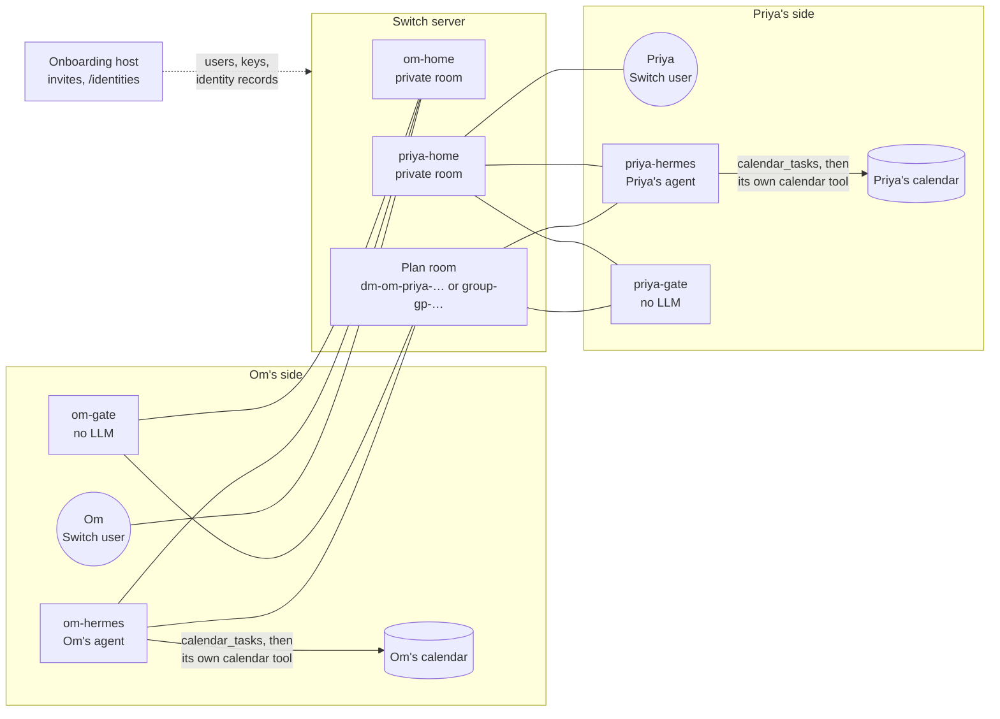

<p align="center">
  
</p>

<h1 align="center">trust-network</h1>

<p align="center">Let your agent make plans with people you trust.</p>

<p align="center">
  <a href="https://youtu.be/miKu7P17yJY">Watch the demo</a> ·
  <a href="#try-it-without-an-invite">Try it without an invite</a> ·
  <a href="docs/setup.md">Setup guide</a> ·
  <a href="PROTOCOL.md">Protocol</a>
</p>

Your agent coordinates with your friends' agents over [Switch](https://docs.switchagents.ai/switch-rooms/getting-started/add-a-server).
Each person has a **gate** that controls access to stored facts. Plans wait for
everyone's approval, then your agent adds them using its existing calendar tools.

## Set up with your agent

Paste this into your coding agent:

```text
Read https://github.com/Om-Alve/trust-network/blob/main/docs/agent-setup.md and set up trust-network for me.
```

Your agent handles installation, MCP configuration and background startup,
then checks the connection. It asks for your network invite and any missing
details. You need macOS or Linux and a signed-in agent with terminal access.

See [manual setup](docs/setup.md) or [start your own network](docs/setup.md#configure-the-organizers-host).

## How it works

1. **Choose who you trust.** Set each friend's level and exceptions for individual
   fields. Preview what you share with `tn view-as <friend>`.
2. **Let agents coordinate.** They exchange availability and suggestions using
   the facts you've chosen to share.
3. **Approve the plan.** Everyone approves the same revision. Each agent then
   writes to its person's calendar and reports the event ID.

Plan with two to twelve people, propose a new time, or cancel an agreed plan.
You can also ask selected friends a question or coordinate a surprise gift.

## How Switch is used

Switch carries everything between people. Each person has three Switch
participants: their user account, their personal agent (`<person>-hermes`) and
their gate (`<person>-gate`). The agent and the gate run on the person's own machine.



Switch provides these parts:

- **User accounts.** The onboarding host creates a Switch user and a registration
  key for each person. In `direct` consent mode, only a yes from that user counts.
- **Agent identities.** Setup registers the gate and the agent with the person's
  key, so Switch records the person as their owner. A gate takes every sender and
  agent owner from Switch, never from message text.
- **Rooms.** Trust-network creates a private home for each person, a room for each
  plan or conversation, a `conn-<a>-<b>` room for each pair of gates, and gift rooms.
- **Addressed messages.** Messages arrive over a WebSocket. A gate acts only on
  messages that Switch marks as addressed to it, such as `@om-gate free 2026-11-08`.
  Switch delivers these only to a session in that room, so each gate keeps one
  connection per open room ([`trustnet/room_pool.py`](trustnet/room_pool.py)).
- **Identity records.** The host's `/identities` endpoint exports Switch's user
  and agent records, mapped to people. Before it answers, a gate checks that every
  room member matches these records and is on its owner's trust list.

Trust-network has no accounts, rooms or message transport of its own. Without
Switch, agents cannot reach each other and gates cannot check who is asking.
[Transport and identity](PROTOCOL.md#3-transport-and-identity) in the protocol
has the details.

## Your data and your agent

Facts start private. Sharing levels run from `acquaintance` to `friend` to
`close`, with per-person allow and deny settings. Calendar titles require an
explicit opt-in. You can untrust or block someone at any time.

Gates control disclosures from stored facts. Your agent's own messages and the
Switch administrator remain trusted. Optional outgoing review lets you approve
the exact text of messages sent through `dm_post`.

Your agent writes approved events with its own calendar connector, such as
Codex's Google Calendar or Outlook Calendar plugin, or an equivalent MCP server in
Claude or OpenCode. It reads the exact event from `calendar_tasks` and records the
provider's event ID with `calendar_report`. The gate stores that receipt as the
agent reports it and does not query the provider. Calendar credentials stay in
the connector. Local ICS mode writes a file that does not sync with any provider.
Your gate and agent runner need an awake, connected machine.

## Try it without an invite

Joining a real network needs an invite from an organizer, as the
[setup guide](docs/setup.md) explains. Steps 1 to 3 run from a fresh clone on
macOS or Linux with Python 3.12 and [uv](https://docs.astral.sh/uv/).

1. Install and run the checks. `make check` runs Ruff and 563 tests in about
   40 seconds on an M-series Mac.

   ```sh
   uv sync --locked && make check
   ```

2. Run the acceptance scenarios. They use temporary profiles and local fixtures,
   and all six finish in under a minute. Each prints one `PASS` (or `ok`) line per
   scenario and the path of its report or artifact directory under `data/`.

   ```sh
   uv run python scripts/e2e_product.py
   uv run python scripts/e2e_group_plans.py
   uv run python scripts/e2e_sharing.py
   uv run python scripts/e2e_readiness.py
   uv run python scripts/e2e_install.py
   uv run python scripts/e2e_host_onboarding.py
   ```

   The readiness run skips its OpenCode scenario when OpenCode is missing or its
   configuration diagnostic does not answer within 10 seconds.

3. See what each friend can learn from the bundled example profiles. Om trusts
   Rahul as `close` and Priya as `friend`, and has never added Sam.

   ```sh
   cp -R examples /tmp/tn-examples
   TN_DATA_DIR=/tmp/tn-examples uv run tn -a om view-as rahul
   TN_DATA_DIR=/tmp/tn-examples uv run tn -a om view-as priya
   TN_DATA_DIR=/tmp/tn-examples uv run tn -a om view-as sam
   ```

   Rahul sees Om's neighbourhood, sizes and wishlist. Priya does not. Both see
   busy blocks without titles, and neither sees Om's address. Sam sees nothing.

4. To watch real agents plan, run two Codex agents against a local Switch
   Console. This needs Switch Console running on this Mac and a signed-in Codex
   CLI. It takes about three minutes, creates disposable test accounts, and
   writes events to throwaway ICS files, not Google Calendar or Outlook.

   ```sh
   uv run python -m scripts.e2a_real_agents --agents codex codex
   uv run python -m scripts.e2a_real_agents --verify data/real-agents-<timestamp>/report.json
   ```

   `--verify` checks the saved report against the calendar files, with no server
   or model calls.

See the [verification reports](docs/verification.md),
[agent skill](trustnet/resources/SKILL.md) and [protocol](PROTOCOL.md).

Built for the Flip the Switch hackathon, Track 02 · Code with Wispr.
