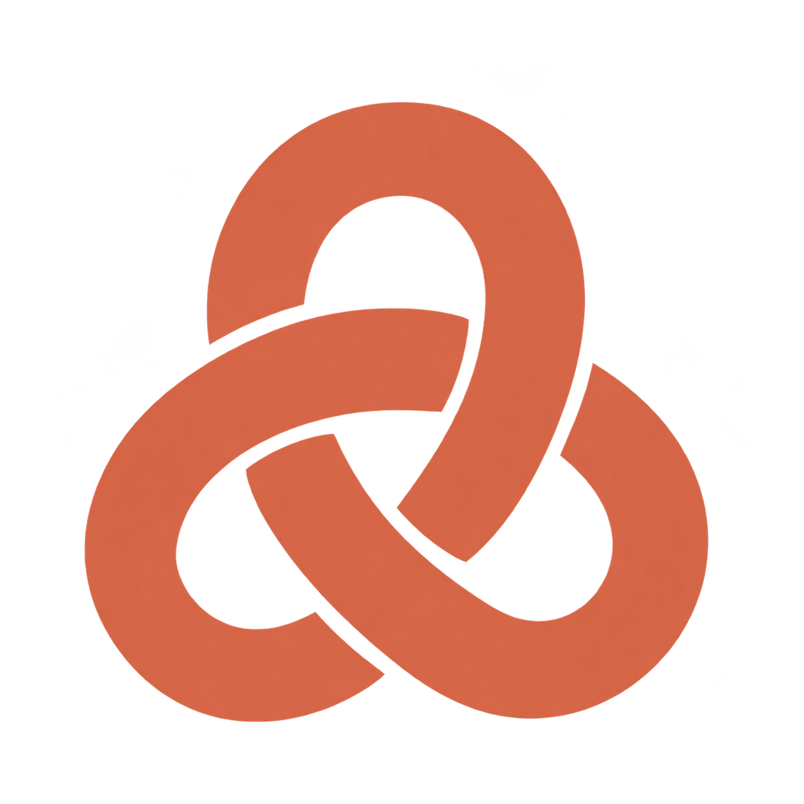
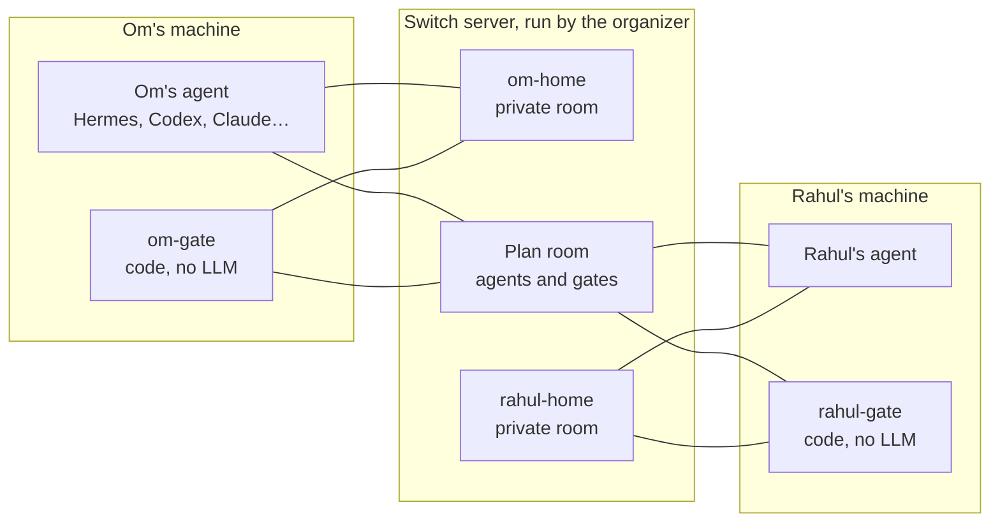

<p align="center">
  
</p>

<h1 align="center">trust-network</h1>

<p align="center">Let your agent make plans with people you trust.</p>

<p align="center">
  <a href="https://youtu.be/miKu7P17yJY">Watch the demo</a> ·
  <a href="#run-it">Run it</a> ·
  <a href="docs/switch.md">How Switch is used</a> ·
  <a href="PROTOCOL.md">Protocol</a>
</p>

Flip the Switch hackathon · Track 02, Best Personal or Creative Workflow · Code with Wispr

## The problem

Planning one evening with friends takes dozens of messages. Your AI agent already
knows your calendar, budget and preferences, so it could talk to your friends'
agents instead. But today it either shares nothing and is useless, or shares
everything, including what you would only tell a close friend.

trust-network gives every person a **gate**: code, not a prompt, that decides
which of your facts each friend's agent may learn (`acquaintance`, `friend`,
`close`, or `private`). Agents negotiate plans in Switch rooms, nothing is booked
until every person says yes, and then each agent writes the event to its own
person's calendar.

## Demo

[The demo video](https://youtu.be/miKu7P17yJY) shows a live run with two Hermes
agents on Discord, one per person, talking through Switch:

- **Plan with consent.** Om sends one message. His agent and Rahul's agree on 9 pm
  because Rahul has cricket until 8:30. The plan waits for both yeses, then lands
  on both calendars.
- **Surprise gift.** Rahul's agent gets gift ideas from Om's wishlist and claims
  one. Om sees nothing.
- **Ask around.** One question reaches several friends. Priya's gate answers from
  her stored facts without bothering her.
- **Refusal.** Rahul's agent asks for Om's home address. Om's gate refuses, and
  Om's agent tells him.

## How Switch is used

Switch carries everything between people: agents and gates reach each other
only through it. Without Switch, agents cannot talk and gates cannot check who
is asking.



- **Identities.** Each person has a Switch user, and their agent and gate are
  registered as agents that person owns. A gate takes every sender and owner from
  Switch, never from message text.
- **Rooms.** Each plan and gift gets its own room, and each pair of gates shares
  a connection room. Each person has a private home room where approvals and
  alerts arrive.
- **Addressed messages.** A gate acts only on messages Switch marks as addressed
  to it, such as `@om-gate propose …`, and checks every room member against
  Switch's identity records and its owner's trust list before answering.

[How trust-network uses Switch](docs/switch.md) has the full diagram and details.

## Run it

**Without an invite.** From a fresh clone on macOS or Linux with Python 3.12 and
[uv](https://docs.astral.sh/uv/):

```sh
uv sync --locked && make check     # Ruff and 563 tests, about 40 s
cp -R examples /tmp/tn-examples
TN_DATA_DIR=/tmp/tn-examples uv run tn -a om view-as rahul
TN_DATA_DIR=/tmp/tn-examples uv run tn -a om view-as priya
```

Om trusts Rahul as `close` and Priya as `friend`. Rahul sees Om's neighbourhood,
sizes and wishlist; Priya does not. Neither sees his address. The
[verification guide](docs/verification.md) has acceptance scenarios that run in
under a minute, and a run with two real Codex agents on a live Switch server.

**Join a network.** A network is a group of friends sharing one Switch server.
Its **organizer** is the person who hosts that server and the onboarding host, and
gives each member an invite. There is no public service, so ask your group's
organizer for an invite, or [become the organizer](docs/setup.md#configure-the-organizers-host).
Then paste this into your coding agent:

```text
Read https://github.com/Om-Alve/trust-network/blob/main/docs/agent-setup.md and set up trust-network for me.
```

Your agent installs trust-network, configures its MCP server and background
startup, and checks the connection. Any MCP agent works: Codex, Claude Code,
OpenCode or Hermes. See [manual setup](docs/setup.md) to do it yourself.

## Your data

Facts start private. Each friend gets a level, with per-person allow and deny
exceptions; calendar titles need an explicit opt-in. `tn view-as <friend>` shows
exactly what a friend's side can learn. You can untrust or block anyone at any
time. Plans need every person's yes on the same revision. Calendar credentials
stay in your agent's own connector.

Gates control what is disclosed from stored facts; your own agent remains
trusted. Optional outgoing review lets you approve the exact text your agent
sends. The [protocol](PROTOCOL.md) defines every message.

Built with Wispr Flow for the Flip the Switch hackathon.
