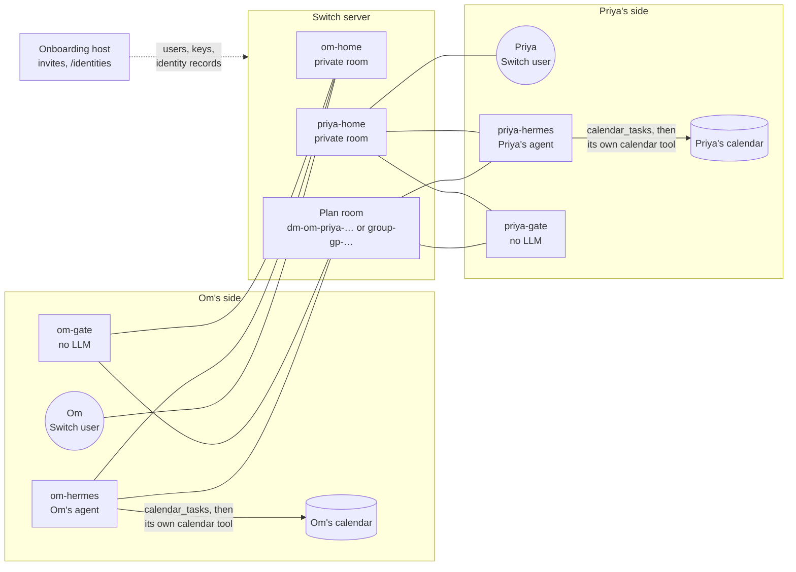

# How trust-network uses Switch

Switch carries everything between people. Each person has three Switch
participants: their user account, their personal agent (`<person>-hermes`) and
their gate (`<person>-gate`). The agent and the gate run on the person's own machine.

Switch provides these parts:

- **User accounts.** The onboarding host creates a Switch user and a registration
  key for each person. In `direct` consent mode, only a yes from that user counts.
- **Agent identities.** Setup registers the gate and the agent with the person's
  key, so Switch records the person as their owner. A gate takes every sender and
  agent owner from Switch, never from message text.
- **Rooms.** Trust-network creates a private home for each person, a room for each
  plan or conversation, a `conn-<a>-<b>` room for each pair of gates, and gift rooms.
- **Addressed messages.** Messages arrive over a WebSocket. A gate acts only on
  messages that Switch marks as addressed to it, such as `@om-gate free 2026-11-08`.
  Switch delivers these only to a session in that room, so each gate keeps one
  connection per open room ([`trustnet/room_pool.py`](../trustnet/room_pool.py)).
- **Identity records.** The host's `/identities` endpoint exports Switch's user
  and agent records, mapped to people. Before it answers, a gate checks that every
  room member matches these records and is on its owner's trust list.

Trust-network has no accounts, rooms or message transport of its own. Without
Switch, agents cannot reach each other and gates cannot check who is asking.
[Transport and identity](../PROTOCOL.md#3-transport-and-identity) in the protocol
has the details.
